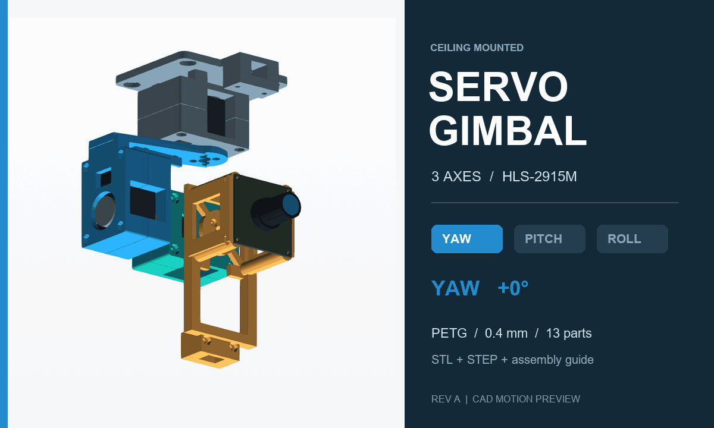
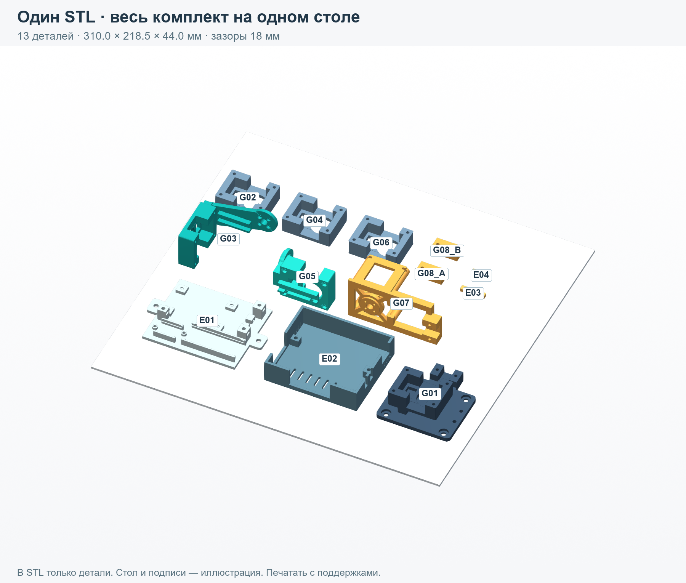
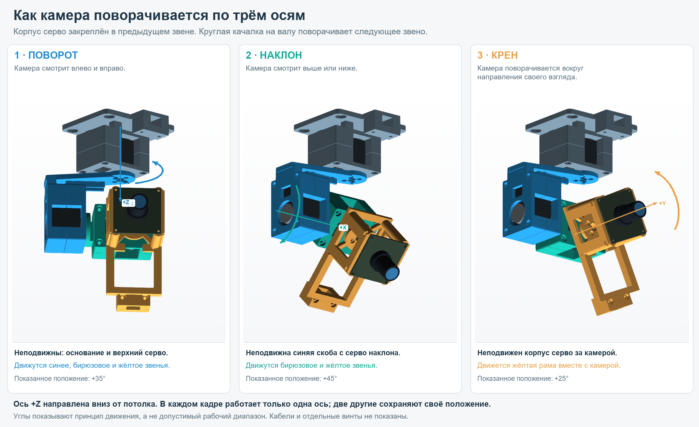
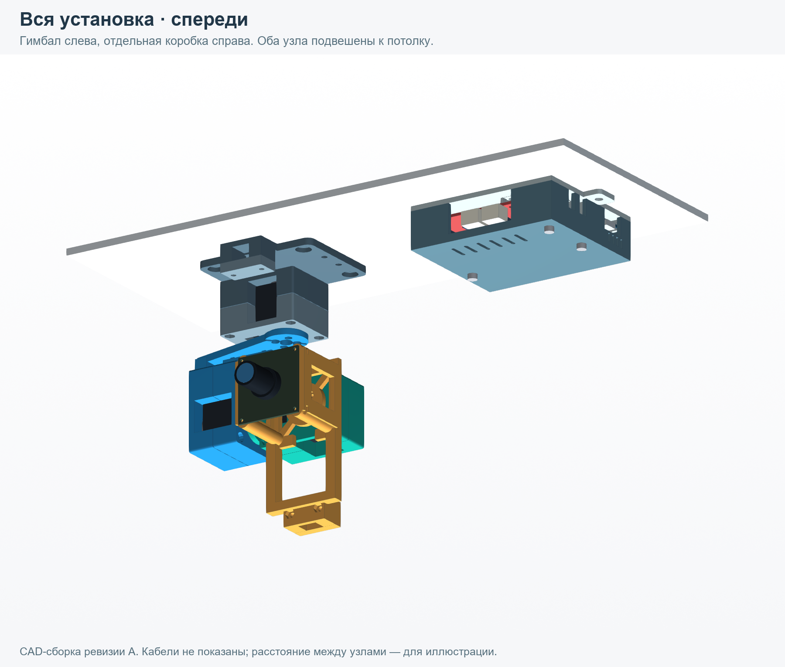
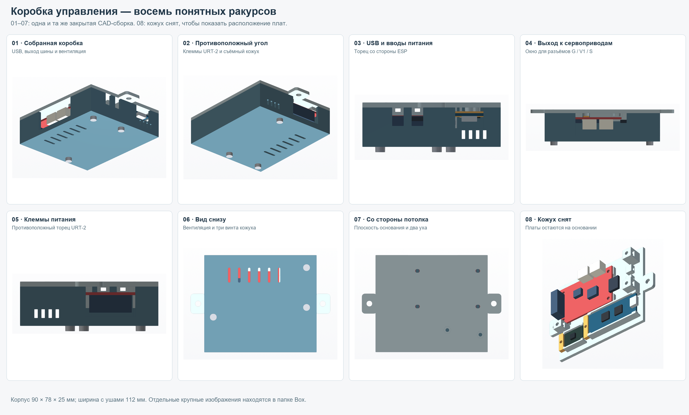
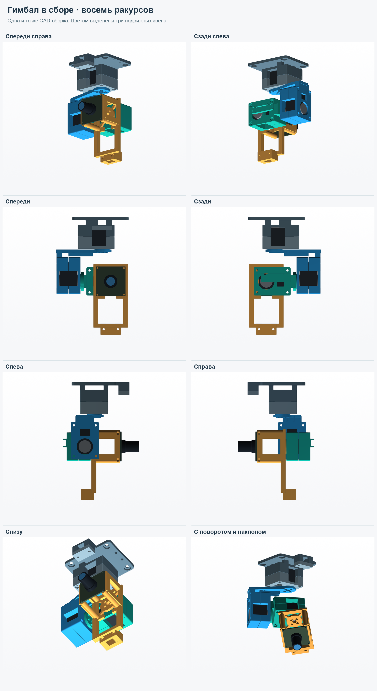

<p align="center">
  
</p>

<h1 align="center">HLS-2915M Servo Gimbal</h1>
<p align="center"><b>Три оси. Отдельная коробка управления. Один STL для печати.</b><br />
Потолочный подвес USB-камеры на трёх шинных сервоприводах Feetech.</p>

<p align="center">
  <a href="print/Gimbal_Enclosure_AllParts_H2S.stl"><b>Основной STL</b></a> ·
  <a href="docs/Assembly_Guide_RevA_RU.pdf">Инструкция по сборке</a> ·
  <a href="docs/Render_Album_RU.pdf">Альбом ракурсов</a> ·
  <a href="cad/step">Редактируемые STEP</a>
</p>

---

**Ревизия A · инженерный прототип.** Геометрия и раскладка проверены; физическая сборка, нагрузочные испытания и работа с настоящими кабелями ещё не проверены. Анимация показывает движение CAD-модели.

## Начать с печати

| Файл | Что внутри |
| :--- | :--- |
| **[Gimbal_Enclosure_AllParts_H2S.stl](print/Gimbal_Enclosure_AllParts_H2S.stl)** | **Основной файл:** все 13 печатных деталей гимбала и коробки на одном столе. |
| [AllParts_H2S.3mf](print/AllParts_H2S.3mf) | Та же актуальная раскладка с отдельными именованными объектами. Только геометрия, без профиля печати. |
| [Отдельные STL](print/parts) | Детали по одной в актуальной ориентации. G08 нужно напечатать **дважды**. |
| [Пробники посадок](print/fit-coupons) | Проверка корпуса серво, диска, отверстий камеры и направляющих плат. |
| [STEP](cad/step) | Отдельные детали и две сборки с упрощёнными моделями компонентов. |



**PETG · сопло 0,4 мм · стол Bambu Lab H2S.** Раскладка занимает **310 × 218,5 × 44 мм**, зазор между деталями — не меньше **18 мм**. Все детали касаются стола, наклонных положений нет. Печатать с поддержками.

1. Сначала проверить посадки пробниками и реальными компонентами.
2. Открыть основной STL или 3MF, оставить масштаб **100%** и исходную ориентацию.
3. Выбрать H2S, сопло 0,4 мм и откалиброванный профиль своего PETG.
4. Включить поддержки; они необходимы для **G01, G03, G05 и G07**. Проверить их в просмотре слоёв, включая нависающие площадки и перемычки.
5. Как начальные настройки использовать слой 0,20 мм, 5 стенок, 6 верхних/нижних слоёв, 35% gyroid и внешнюю кайму около 6 мм.
6. Печатать **по слоям**, сохраняя раскладку. Просмотреть нарезку перед запуском.

В папке `print/` используется уточнённая ориентация G03, G05, G06 и G07. Она имеет приоритет над первоначальным описанием ориентации в PDF ревизии A. Форма деталей не изменилась. Подробности: [заметки по печати](docs/PRINT_RU.txt).

## Как движется камера

Корпус каждого сервопривода зажат в предыдущем кронштейне. Его круглый выходной диск прикручен к следующему кронштейну.

| Ось | Что поворачивается |
| :--- | :--- |
| **Поворот / Yaw** | Верхний привод разворачивает весь нижний узел влево и вправо. |
| **Наклон / Pitch** | Боковой привод наклоняет третий привод вместе с камерой. |
| **Крен / Roll** | Привод за камерой вращает её рамку вокруг направления взгляда. |



Это механический проект без прошивки. Команды приводам должен задавать ESP через URT-2. ИМУ в отдельной коробке измеряет ориентацию основания; обратная связь непосредственно по положению камеры им не обеспечивается. Работа как автоматического стабилизатора здесь не подтверждена.

## Два отдельных потолочных узла



**Гимбал:** три HLS-2915M, камера в винтовой рамке, каналы межсервовых проводов и два прижима USB-кабеля. Размер твёрдой сборки в нейтральном положении — примерно **93 × 98 × 150 мм**, без свободных кабельных петель.

**Коробка:** URT-2 на винтовых стойках; ESP и ИМУ в приподнятых направляющих со стопорами. USB-C, выход G / V1 / S и вводы питания доступны снаружи. Кожух снимается вниз; вентиляция находится снизу и по бокам. Корпус **90 × 78 × 25 мм**, ширина с потолочными ушами — **112 мм**.

Оба узла прикручиваются к потолку снизу. От коробки к гимбалу идёт одна сервошина. USB камеры подключается отдельно к компьютеру; свободные петли нужны на переходах между подвижными звеньями. Непрерывное вращение на 360° не предусмотрено.

<details>
<summary><b>Коробка: восемь ракурсов</b></summary>
<br />

</details>

<details>
<summary><b>Гимбал: восемь ракурсов</b></summary>
<br />

</details>

## Компоненты, под которые сделана модель

| Компонент | Количество | Основа размеров |
| :--- | :---: | :--- |
| Feetech **HLS-2915M**, код **HL-2915-C001** | 3 | Корпус 34 × 20 × 23 мм; диск около Ø16 мм. |
| Плата ESP с USB-C | 1 | **51 × 21 мм**, как на исходном изображении. Названия ESP32-C3 недостаточно для проверки совместимости. |
| Интерфейсная плата **URT-2** | 1 | Крепление через штатные отверстия; слоты учитывают расхождение размеров в чертеже и таблице. |
| Плата ИМУ | 1 | 20 × 15 × 1 мм, без штырьковых разъёмов. |
| USB-камера **DECXIN-2M-2159V1** | 1 | Плата 38 × 38 мм; отверстия на квадрате 34 × 34 мм. |
| Межсервовые кабели | По цепочке | Замеренная длина 210 мм от края штекера до края штекера. |
| USB-кабель камеры | 1 | Диаметр около 7 мм; малый штекер шириной около 9 мм. |

Крепёж и порядок сборки находятся в [инструкции](docs/Assembly_Guide_RevA_RU.pdf). Перед подбором винтов дисков нужно проверить реальную резьбу: отметка **Ø1,6** на чертеже не означает автоматически M2.

## Что проверено

- Замкнутость сеток, связность отдельных деталей и отсутствие пересечений в раскладке.
- В основном STL — **13 отдельных замкнутых деталей**, каждая на Z = 0.
- В CAD проверены **75 отдельных положений** твёрдой сборки без обнаруженных пересечений: yaw −75 / 0 / +75°, pitch −10 / 0 / 30 / 60 / 90°, roll −30 / −15 / 0 / 15 / 30°.

Эти выборочные проверки не подтверждают непрерывную траекторию, свободный ход кабелей, прочность, люфт и ресурс. Проверки и исходные допущения сохранены в [`validation/`](validation). Механических ограничителей вращения нет.

Питание и распиновку нужно сверить по своим платам. **V2 на URT-2 не следует считать входом 5 В логики.** Разъёмы платы и сервоприводов могут требовать переходного кабеля.

## Файлы проекта

```text
print/        Основной STL, 3MF, отдельные детали и пробники
cad/step/     Редактируемые модели и сборки
cad/source/   Исходная геометрия на CadQuery, без прошивки
docs/         Инструкция, альбом ракурсов, заметки по печати
renders/      Крупные виды гимбала, коробки и всей установки
assets/       Анимированная обложка и обзорные изображения
validation/   Отчёты геометрических проверок
```

[Статичная обложка](assets/hero.png) · [Подписанная анимация](assets/motion-explained.gif) · [Все ракурсы](renders) · [CAD-исходники](cad/source)
